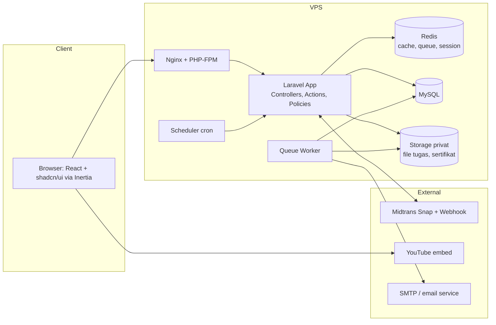
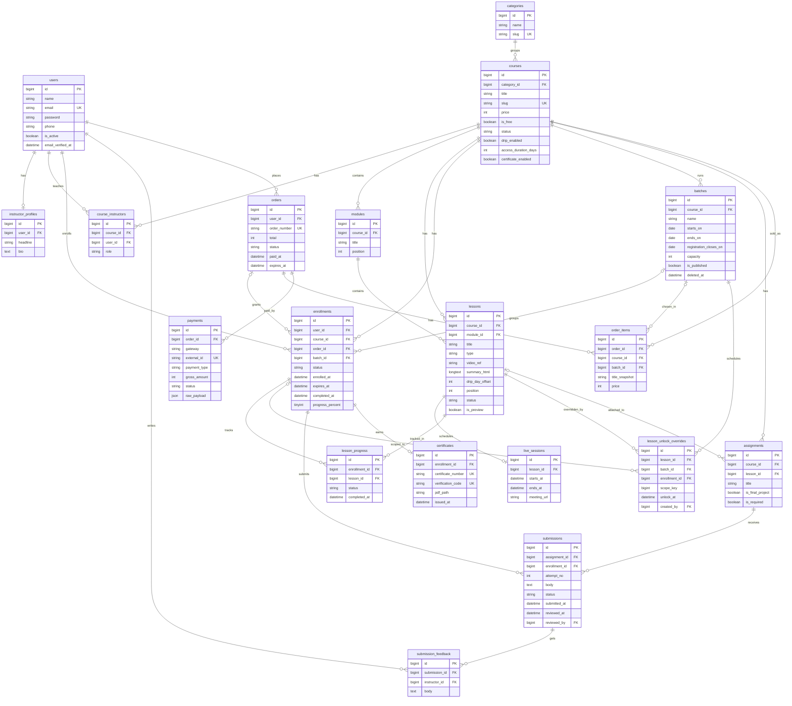

# Rancangan Arsitektur & ERD: LMS Kursus Online

Tanggal: 2026-11-13 · Status: draf 1 (untuk direview)

## 1. Ringkasan, asumsi, dan keputusan teknis

**Produk:** LMS untuk satu penyedia kursus online umum. Siswa mendaftar sendiri, membeli kursus (atau mengambil kursus gratis), belajar lewat video + rangkuman teks, mengumpulkan tugas, dan mendapat sertifikat otomatis.

**Asumsi (ubah jika salah):**
- Skala: 500 - 5.000 siswa aktif di tahun pertama.
- Satu klien, bukan multi-tenant. Branding lewat design token (CSS variables), bukan sistem tema dinamis.
- Payment gateway: Midtrans (Snap) lewat lapisan abstraksi sehingga bisa diganti Xendit.
- Video di YouTube (unlisted), diputar lewat embed. Lapisan video dipisah agar mudah diganti Bunny/Vimeo.
- Live class: tautan dan jadwal diisi manual (tanpa API Zoom/Meet).
- Kuis, diskusi, kupon, dan bundle ditunda ke tahap 2.

**Stack:**

| Lapisan | Pilihan |
|---|---|
| Backend | Laravel (versi stabil terbaru), PHP 8.3+ |
| Frontend | Inertia + React + shadcn/ui + Tailwind (starter kit resmi Laravel) |
| Database | MySQL 8 |
| Cache, queue, session | Redis |
| Storage file | Disk privat (lokal atau S3-compatible) dengan signed URL |
| Auth | Session (Fortify dari starter kit), verifikasi email |
| Role/permission | spatie/laravel-permission |
| PDF sertifikat | barryvdh/laravel-dompdf (atau Browsershot jika desain kompleks) |
| Log aktivitas | spatie/laravel-activitylog (opsional) |

## 2. Arsitektur sistem

Monolit modular: satu aplikasi Laravel, dipisah per modul di level folder. Ini cukup untuk skala target dan jauh lebih mudah dirawat sendirian dibanding microservices.



**Komponen dan tanggung jawab:**
- **Laravel App:** controller tipis, logika bisnis di `Actions` (kelas satu tugas, contoh `EnrollStudent`, `ComputeLessonAccess`, `IssueCertificate`). Otorisasi lewat Policy.
- **Queue worker:** kirim email, buat PDF sertifikat, proses webhook berat, notifikasi lesson baru.
- **Scheduler:** pengingat lesson baru terbuka, tandai enrollment kedaluwarsa, bersihkan order pending yang kedaluwarsa.
- **Redis:** queue, cache (katalog, hitung akses), dan session.
- **Storage privat:** file tugas siswa dan gambar feedback tidak pernah publik; diakses lewat signed URL berumur pendek.
- **Midtrans:** Snap untuk pembayaran, webhook untuk konfirmasi (diverifikasi signature dan idempoten).
- **YouTube:** hanya embed. ID video baru dikirim ke frontend jika lesson sudah terbuka untuk siswa itu.

## 3. Struktur modul Laravel dan otorisasi

```
app/
  Actions/           # satu kelas = satu use case
    Enrollment/  Payment/  Learning/  Assignment/  Certificate/
  Enums/             # CourseStatus, OrderStatus, SubmissionStatus, dst.
  Http/Controllers/
    Public/  Student/  Instructor/  Admin/  Webhook/
  Models/
  Policies/          # CoursePolicy, LessonPolicy, SubmissionPolicy, OrderPolicy
  Services/
    Payment/PaymentGateway.php (interface) + MidtransGateway.php
    Video/VideoProvider.php (interface) + YouTubeProvider.php
  Jobs/  Notifications/  Console/
resources/js/Pages/   # Public, Student, Instructor, Admin
```

**Peran dan hak akses:**

| Peran | Hak utama |
|---|---|
| Admin | Semua: kursus, pengguna, order, laporan, pengaturan |
| Staf | Lihat/kelola order dan konfirmasi pembayaran manual, bantu siswa, moderasi; tidak mengubah konten kursus |
| Instruktur | Hanya kursus yang ditugaskan: atur pembukaan lesson, lihat siswa dan progres, periksa tugas, beri feedback |
| Siswa | Beli/ambil kursus, belajar lesson yang terbuka, kumpulkan tugas, unduh sertifikat sendiri |

**Halaman utama:**
- Publik: beranda, katalog, detail kursus, login/daftar, verifikasi sertifikat (`/verify/{kode}`).
- Siswa: dashboard, kursus saya, player lesson, tugas saya, riwayat order, sertifikat.
- Instruktur: kursus saya, daftar siswa, pengaturan pembukaan lesson, antrean tugas masuk, form feedback.
- Admin/staf: CRUD kursus/modul/lesson, pengguna, order/pembayaran, laporan, pengaturan (branding, sertifikat).

## 4. Alur utama

**A. Beli kursus berbayar**
1. Siswa klik beli, sistem membuat `orders` (pending) + `order_items` (harga disalin sebagai snapshot).
2. Server meminta Snap token ke Midtrans, siswa membayar.
3. Webhook Midtrans masuk. Sistem memverifikasi signature, mencatat di `webhook_events` (unik per event, agar idempoten), lalu dalam satu transaksi database: update `payments`, set order `paid`, buat `enrollments` (status `active`, `enrolled_at = now`).
4. Notifikasi email dikirim lewat queue.

Kursus drip: siswa memilih **batch** (angkatan) di halaman kursus/checkout; `order_items.batch_id` menyimpan pilihan itu,
dan enrollment yang dibuat setelah pembayaran sukses memakai batch tersebut. Batch divalidasi ulang saat membuat order
(terbit, belum selesai, pendaftaran belum ditutup, kuota belum penuh). Pembayaran yang sudah sukses **tidak pernah ditolak**
karena batch penuh: siswa tetap masuk, kelebihan dicatat di log dan ditandai untuk admin. Order pending dipakai ulang hanya
untuk batch yang sama.

**B. Kursus gratis:** siswa klik ambil, langsung dibuat `enrollments` tanpa order (`order_id` null). Kursus drip gratis tetap
wajib memilih batch.

**C. Belajar dengan drip (gabungan)**

Waktu buka sebuah lesson dihitung saat dibaca oleh `ComputeLessonAccess`, tanpa job penjadwal:
1. Kursus tanpa drip (`drip_enabled = false`): semua lesson published terbuka sejak enrollment, tanpa batch.
2. Lesson pratinjau (`is_preview`) selalu terbuka.
3. Override per siswa (`lesson_unlock_overrides.enrollment_id = X`, batch siswa itu). Jika ada, pakai.
4. Jika tidak, override batch (`enrollment_id IS NULL`, `batch_id` = batch siswa). Jika ada, pakai.
5. Jika tidak ada, pakai default: `batches.starts_on + lessons.drip_day_offset hari` pukul `LESSON_UNLOCK_TIME` (default 00:00)
   zona `Asia/Jakarta`. Hari ke-1 = tanggal mulai batch (offset 0); UI menampilkan "Hari ke-(offset+1)".
   Enrollment drip lama tanpa batch memakai `enrolled_at` sebagai titik mulai (fallback).
6. Lesson dapat diakses jika enrollment aktif dan belum kedaluwarsa, kursus `published` atau `archived` (bukan draft),
   lesson berstatus published di modul yang tidak terhapus, dan waktu buka sudah lewat.
7. **Lesson yang sudah terbuka tidak pernah terkunci kembali**: override tidak boleh menggeser lesson yang sudah terbuka
   ke masa depan, dan reset ke default ditolak bila akan mengunci ulang. Lesson berikutnya tetap mengikuti jadwal, tidak
   bergantung pada tugas.

Instruktur yang ditugaskan (dan admin) mengatur jadwal di `/kelas/{kursus}/batch/...`: per batch atau per siswa.
Admin dapat memindahkan siswa ke batch lain (`MoveEnrollmentToBatch`): override per siswa di batch lama dihapus, lesson yang
sudah terbuka tetap terbuka lewat override per siswa di batch baru.

Siswa menandai lesson selesai (tombol, atau otomatis saat video YouTube berakhir lewat IFrame API), tercatat di
`lesson_progress`. `enrollments.progress_percent` = floor(selesai / lesson published) dan dihitung ulang
(`RecalculateCourseProgress`, unik per kursus) saat lesson diterbitkan, ditarik, atau dihapus. Progres 100% belum
menyelesaikan enrollment (kelulusan & sertifikat di fase berikutnya).

**D. Tugas dan feedback**
1. Siswa mengunggah jawaban (teks + file) pada lesson atau proyek akhir, dibuat `submissions` (status `submitted`).
2. Instruktur melihat antrean, memberi feedback tulisan dan/atau gambar (`submission_feedback` + `attachments`), lalu menetapkan status: `approved` atau `needs_revision`.
3. Jika `needs_revision`, siswa mengirim ulang sebagai percobaan baru (`attempt_no` naik).
4. Siswa dinotifikasi setiap ada feedback.

**E. Sertifikat**
1. Setelah lesson terakhir selesai atau tugas wajib disetujui, sistem mengecek syarat kelulusan.
2. Jika terpenuhi, job `IssueCertificate` membuat nomor dan kode verifikasi, membuat PDF, menyimpan ke `certificates`, dan menandai enrollment `completed`. Kolom `enrollment_id` yang unik mencegah sertifikat ganda meski job berjalan dua kali.

## 5. Diagram ERD



Tabel pendukung yang tidak digambar agar diagram tetap terbaca: `attachments` (polimorfik, untuk file submission dan gambar feedback), `webhook_events`, `settings`, `notifications` (bawaan Laravel), dan tabel paket spatie (`roles`, `permissions`, dst.).

## 6. Kamus tabel

Semua tabel memakai `id` bigint unsigned auto-increment, `created_at`, `updated_at`. Harga disimpan sebagai integer rupiah (tanpa desimal). Kolom `status` memakai string yang dipetakan ke Enum PHP.

### Inti pengguna dan katalog
| Tabel | Kolom penting | Catatan / indeks |
|---|---|---|
| `users` | name, email (unik), password, phone, avatar_path, is_active, email_verified_at | Role lewat spatie |
| `instructor_profiles` | user_id (unik), headline, bio | Tampil di halaman kursus |
| `categories` | name, slug (unik), parent_id (null) | |
| `courses` | category_id, title, slug (unik), summary, description, thumbnail_path, price, is_free, status (`draft`/`published`/`archived`), drip_enabled, access_duration_days (null = selamanya), certificate_enabled, published_at, created_by | Indeks (status, published_at) |
| `course_instructors` | course_id, user_id, role (`lead`/`assistant`) | Unik (course_id, user_id); dipakai Policy "instruktur kursus ini" |

### Kurikulum
| Tabel | Kolom penting | Catatan / indeks |
|---|---|---|
| `modules` | course_id, title, position | Indeks (course_id, position) |
| `lessons` | course_id, module_id, title, slug, type (`video`/`live`), video_provider, video_ref, duration_seconds, summary_html, drip_day_offset (hari ke-N sejak mulai; 0 = langsung), position, status, is_preview | Indeks (course_id, position); `video_ref` jangan dikirim ke frontend jika lesson terkunci |
| `live_sessions` | lesson_id (unik), starts_at, ends_at, platform, meeting_url, notes | Diisi manual |

### Akses dan progres
| Tabel | Kolom penting | Catatan / indeks |
|---|---|---|
| `batches` | course_id, name, starts_on (Hari ke-1), ends_on, registration_closes_on (null = sampai ends_on), capacity (null = tak terbatas), is_published, deleted_at | Hanya untuk kursus drip. Status dihitung dari tanggal: `upcoming`/`running`/`finished`. Indeks (course_id, starts_on). Soft delete; batch yang punya siswa tidak bisa dihapus. `starts_on` tidak bisa diubah setelah batch dimulai; kuota tidak boleh di bawah jumlah siswa |
| `enrollments` | user_id, course_id, order_id (null untuk gratis), batch_id (null untuk kursus non-drip), status (`active`/`completed`/`expired`/`revoked`), enrolled_at, expires_at, completed_at, progress_percent | Unik (user_id, course_id); indeks (course_id, status), (batch_id, status). FK batch `restrictOnDelete`. Kuota batch dihitung dari enrollment `active`/`completed` |
| `lesson_unlock_overrides` | lesson_id, batch_id, enrollment_id (null = seluruh batch), scope_key, unlock_at, created_by | Tanpa `is_locked` (lesson terbuka tidak pernah dikunci ulang). Unik (lesson_id, batch_id, scope_key) dengan `scope_key = enrollment_id ?? 0` diisi oleh model (kolom generated tidak dipakai karena MySQL menolak FK cascade pada kolom dasarnya). Prioritas: per siswa > batch > default |
| `lesson_progress` | enrollment_id, lesson_id, status (`in_progress`/`completed`), watched_seconds, completed_at | Unik (enrollment_id, lesson_id) |

### Tugas
| Tabel | Kolom penting | Catatan / indeks |
|---|---|---|
| `assignments` | course_id, lesson_id (null untuk proyek akhir), title, instructions_html, is_final_project, is_required, allow_images | Indeks (course_id, lesson_id) |
| `submissions` | assignment_id, enrollment_id, attempt_no, body, status (`submitted`/`needs_revision`/`approved`), submitted_at, reviewed_at, reviewed_by | Unik (assignment_id, enrollment_id, attempt_no); indeks (assignment_id, status) untuk antrean instruktur |
| `submission_feedback` | submission_id, instructor_id, body | Bisa lebih dari satu per submission |
| `attachments` | attachable_type, attachable_id, disk, path, original_name, mime, size, uploaded_by | Polimorfik ke submission dan feedback; disk privat |

### Pembayaran
| Tabel | Kolom penting | Catatan / indeks |
|---|---|---|
| `orders` | user_id, order_number (unik), subtotal, discount (default 0), total, status (`pending`/`paid`/`failed`/`expired`/`refunded`), paid_at, expires_at | Indeks (user_id, status) |
| `order_items` | order_id, course_id, batch_id (kursus drip), title_snapshot, price | Snapshot harga; batch pilihan siswa (divalidasi ulang saat order dibuat); siap untuk bundle di tahap 2 |
| `payments` | order_id, gateway, external_id (unik), payment_type, gross_amount, status, raw_payload (json), paid_at | Satu order bisa punya beberapa percobaan |
| `webhook_events` | gateway, event_id, payload (json), processed_at | Unik (gateway, event_id) untuk idempotensi |

### Sertifikat dan pengaturan
| Tabel | Kolom penting | Catatan / indeks |
|---|---|---|
| `certificates` | enrollment_id (unik), certificate_number (unik), verification_code (unik), pdf_path, issued_at | Satu sertifikat per enrollment |
| `settings` | key (unik), value (json) | Nama brand, logo, teks sertifikat, kontak |

## 7. Aturan bisnis penting, keamanan, dan ditunda ke tahap 2

**Aturan bisnis:**
- Enrollment dibuat hanya setelah order `paid` (berbayar) atau langsung (gratis). Tidak ada enrollment ganda untuk user dan kursus yang sama.
- Perubahan harga kursus tidak memengaruhi order lama (snapshot di `order_items`).
- Lesson yang dihapus setelah ada progres sebaiknya diarsipkan (status `draft`), bukan dihapus, agar riwayat tidak rusak.
- Kursus selesai jika semua lesson `published` yang wajib berstatus `completed` dan semua tugas wajib `approved`. Aturan pasti bisa disesuaikan dengan klien.
- Kedaluwarsa akses (`access_duration_days`) dihitung dari `enrolled_at` (kursus non-drip) atau dari akhir batch
  (`ends_on` 23:59, kursus drip); null berarti seumur hidup.
- Kursus drip baru bisa diterbitkan jika punya minimal 1 batch terbit. Pendaftaran batch terbuka jika batch terbit, hari ini
  ≤ `ends_on` dan ≤ `registration_closes_on`, serta kuota belum penuh.
- Lesson yang sudah terbuka tidak pernah terkunci kembali; jadwal lesson berikutnya tidak bergantung pada tugas.
  Karena itu `drip_day_offset` lesson published tidak bisa dimundurkan bila lesson itu sudah terbuka menurut jadwal
  default di batch (yang sudah dimulai dan punya siswa) dan akan terkunci lagi dengan offset baru (`SaveLesson`).

**Keamanan:**
- Semua pengecekan akses dilakukan di server (Policy + `ComputeLessonAccess`), bukan hanya disembunyikan di UI.
  Player (`/belajar`) hanya mengirim embed video, `summary_html`, dan `meeting_url` untuk lesson yang sudah terbuka bagi
  siswa itu; lesson terkunci hanya mengirim judul dan tanggal buka (diuji di `tests/Feature/Learning/LearnPlayerTest.php`).
- YouTube unlisted tidak bisa mencegah tautan dibagikan. Mitigasi: ID video hanya dikirim ke siswa yang berhak. Untuk proteksi lebih kuat, ganti ke Bunny/Vimeo lewat `VideoProvider`.
- Upload: batasi tipe dan ukuran, simpan di disk privat, nama file diacak, tampilkan lewat signed URL.
- Webhook pembayaran: verifikasi signature, idempoten, dan hanya percaya data dari webhook (jangan dari redirect browser).
- Rate limiting untuk login, daftar, dan unggah. Verifikasi email wajib sebelum beli.

**Ditunda ke tahap 2:** kuis/ujian, diskusi per lesson, kupon dan bundle, integrasi API Zoom/Meet, notifikasi WhatsApp, laporan lanjutan, review/rating kursus.

## 8. Roadmap implementasi dan risiko

| Fase | Isi | Hasil yang bisa didemokan |
|---|---|---|
| 0 | Setup proyek, starter kit React, CI, design token sementara, struktur folder | Aplikasi kosong yang bisa login |
| 1 | Auth, role/permission, katalog, halaman detail kursus | Katalog publik |
| 2 | Admin: CRUD kursus, modul, lesson (video, rangkuman, live) | Admin bisa menginput kursus |
| 3 | Order, Midtrans (sandbox), webhook, enrollment, kursus gratis | Beli dan dapat akses |
| 4 | Batch (angkatan) per kursus drip, player lesson, drip per batch + override instruktur (batch/siswa), progres | Alur belajar lengkap |
| 5 | Tugas, submission, antrean instruktur, feedback tulisan + gambar | Siklus tugas selesai |
| 6 | Sertifikat PDF + halaman verifikasi | Kursus bisa diselesaikan |
| 7 | Notifikasi, laporan dasar, hardening, backup, deploy VPS | Siap diserahkan |

**Risiko utama:**
- **Aturan drip yang berbeda dari yang dibayangkan klien.** Konfirmasikan contoh nyata (kapan hari ke-1 dimulai, apa yang terjadi jika siswa tertinggal) sebelum fase 4.
- **Kebocoran video YouTube.** Sampaikan batasan ini ke klien sejak awal.
- **Webhook pembayaran.** Uji lengkap di sandbox (sukses, gagal, kedaluwarsa, webhook ganda).
- **Branding belum ada.** Pakai design token supaya penggantian tidak menyentuh komponen.
- **Scope creep.** Fitur tahap 2 baru dikerjakan setelah MVP diterima klien.

**Pertanyaan terbuka untuk klien:**
1. Syarat lulus sertifikat: semua lesson selesai saja, atau juga semua tugas wajib disetujui?
2. ~~Apakah lesson berikutnya menunggu tugas disetujui?~~ Diputuskan di Fase 4: tetap terbuka sesuai jadwal batch.
3. Akses kursus seumur hidup atau ada batas waktu?
4. Apakah refund diperlukan, dan bagaimana akses dicabut saat refund?
